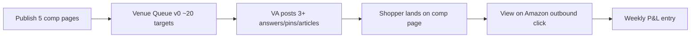

# Vertical Slice — Catalog Bridge (idea 018)

**Status:** Approved at graduation  
**Last updated:** 2026-08-10  
**Parent:** [`TECH_PLAN.md`](TECH_PLAN.md) defines full architecture; this doc defines the **first buildable proof path**.

---

## Purpose

Prove the commission loop works end-to-end before investing in the Answer Insertion Engine or 100-venue portfolio:

> **5 constraint comp pages live → VA posts in 3+ venues → shopper lands on catalog → clicks Amazon → commission attributed → weekly P&L recorded**

If this slice shows attributable clicks (commission optional but strongly preferred), mechanics are ready to expand venues and automation.

---

## Golden path



---

## In scope

### Catalog (site)

| # | Comp page | Slug (proposed) | Constraint |
|---|-----------|-----------------|------------|
| 1 | Best air fryer for small kitchen under $100 | `air-fryer-small-kitchen-under-100` | Footprint + budget |
| 2 | Best air fryer for 1–2 people | `air-fryer-1-2-people` | 2–4 qt capacity |
| 3 | Best compact electric kettle for dorm/small apartment | `compact-kettle-small-kitchen` | Counter space |
| 4 | Best vegetable chopper for beginners | `vegetable-chopper-beginners` | Meal prep entry |
| 5 | Best milk frother under $25 | `milk-frother-under-25` | Budget coffee at home |

**Each page must include:**
- Constraint stated in title + intro (who it’s for / not for)
- 3–5 ASIN picks with *best for / skip if*
- Comparison table: price band, size/capacity, key spec, review signal
- Methodology blurb (spec + public reviews; not hands-on unless true)
- FTC affiliate disclosure
- `updated_at` date
- Associates-tagged Amazon outbound links **only here**

### Venue ops (manual / VA)

| Deliverable | Minimum |
|-------------|---------|
| `data/venue-queue.json` | ~20 venues with adapter, comp mapping, rules notes |
| VA playbooks | Quora, Pinterest, Medium — warm-up + post + disclosure |
| Live posts | ≥ 3 placements pointing at matching comp pages |
| Post log | URL, venue, comp slug, date (spreadsheet or JSON) |

**Adapter priority for slice:** Quora + Pinterest + Medium (fast eyes). Reddit/SEO in parallel but not required for slice done.

### P&L

| Deliverable | Minimum |
|-------------|---------|
| Weekly template | `data/pl/week-template.csv` or spreadsheet |
| Lines | hosting, domain, VA hours, compute, commission (Associates report) |
| Week 1 entry | Opex recorded even if commission = $0 |

### Compliance (non-negotiable)

- External posts: **catalog URL only** — never raw `amazon.com` affiliate links
- Match-only: post only when comp page fits the question
- No “we tested” unless true
- No health/medical/pressure-cooker safety deep dives

---

## Out of scope (explicit)

| Area | Defer to |
|------|----------|
| Answer Insertion Engine auto-discover/post | Phase 2 |
| Reddit OAuth auto-post | After karma warm + API spike |
| 100+ venue discovery loop | Phase 3 |
| Facebook Groups | VA warm project |
| Email capture | After first commission signal |
| Compare-tool interactive UI | Phase 4 |
| Pets niche | After kitchen proof |
| Second merchant rail | After EPC baseline |
| Supabase / engine DB | Optional until phase 2 |
| Paid ads → Amazon or catalog | Policy check; not default |

---

## Repo layout (target)

```
catalog-bridge/
  README.md
  TECH_PLAN.md
  BUSINESS_CASE.md
  VERTICAL_SLICE.md
  apps/web/                 # Next.js site (phase 1 build)
  content/comps/            # MDX comp pages
  data/
    venue-queue.json
    pl/
  docs/
    va-quora-playbook.md
    va-pinterest-playbook.md
    va-medium-playbook.md
    comp-methodology.md
  .env.example              # ASSOCIATES_TAG, analytics, etc.
```

---

## Acceptance checklist

- [ ] Domain registered; Associates application submitted (or approved)
- [ ] 5 comp pages published and reachable
- [ ] Every page has disclosure + methodology + dated picks table
- [ ] Outbound Amazon links tagged correctly on-site only
- [ ] Analytics or logs capture outbound clicks
- [ ] Venue queue has ~20 entries with comp mappings
- [ ] ≥ 3 live venue posts (Quora/Pinterest/Medium) with catalog links
- [ ] Post log documents what went where
- [ ] Week 1 P&L row exists (opex at minimum)
- [ ] Zero external posts with raw Amazon affiliate URLs

---

## Definition of done

**Minimum:** 5 live comps + 3 venue posts + outbound click recorded + P&L week 1 filed.

**Strong:** Above + first attributed commission on Associates report.

**Fail / pivot signal:** 4–6 weeks active posting, clicks near zero, zero commission → revisit constraints, pages, or niche before building engine.

---

## Estimated effort

| Block | Estimate |
|-------|----------|
| Site scaffold + comp template | 3–5 days |
| 5 comp pages (research + write) | 3–5 days |
| Venue queue + VA playbooks | 2 days |
| Associates + domain setup | 1–2 days (approval wait external) |
| 3+ venue posts | 2–3 days |
| **Total** | **~2–3 weeks** part-time |

---

## After the slice

1. Pages 6–10 (Tier B comps from feasibility research)  
2. SEO indexing + Search Console  
3. Reddit allowlist + karma warm (parallel)  
4. Engine MVP: discover + draft + approve queue  
5. Venue count → 50 → 100+ with P&L allocator  
6. Compare utility + email capture  
7. Pets niche clone if kitchen P&L positive  

---

## References

| Doc | Role |
|-----|------|
| [`TECH_PLAN.md`](TECH_PLAN.md) | Full architecture |
| [`BUSINESS_CASE.md`](BUSINESS_CASE.md) | Market / decision |
| Hub `notes.md` | Channel research, kitchen feasibility, multipliers |
